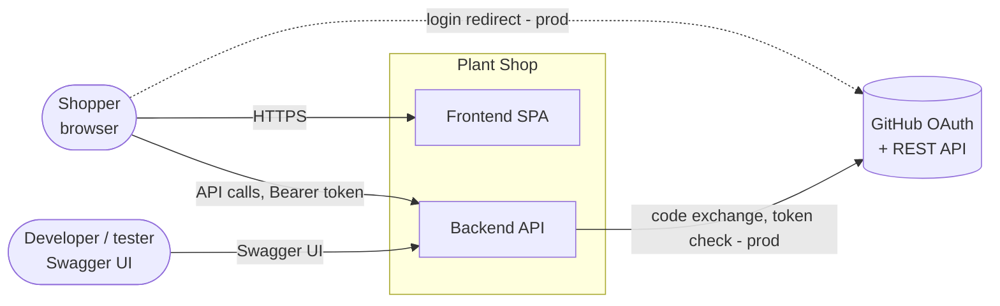
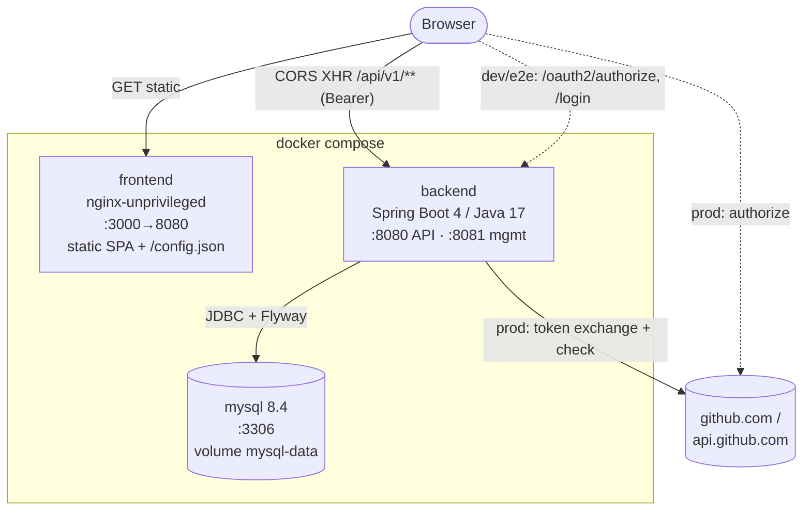
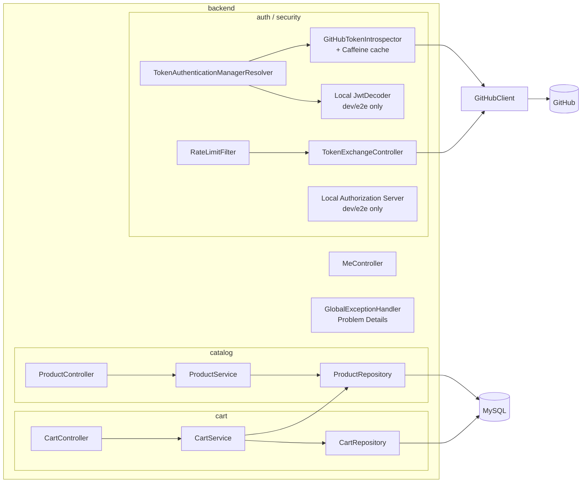
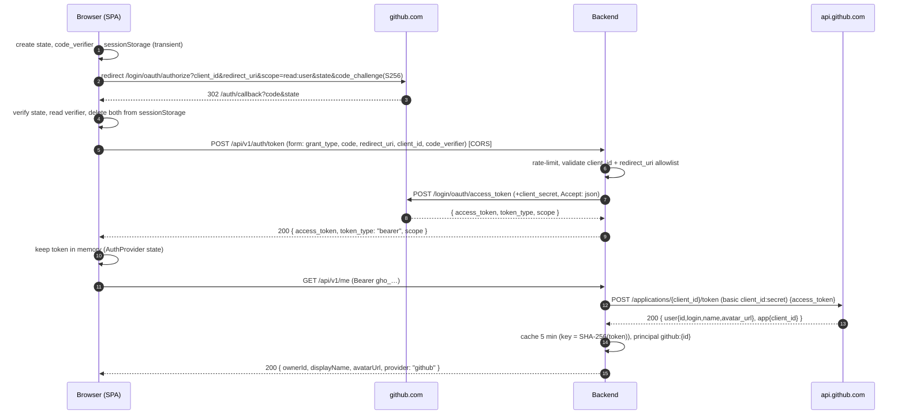
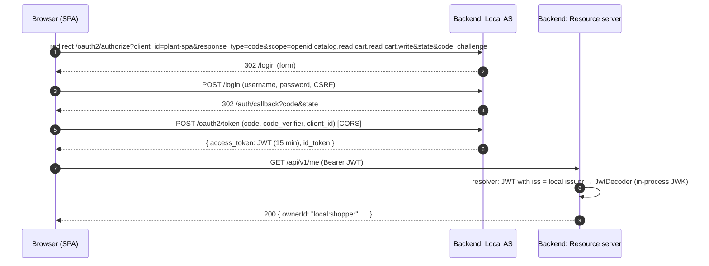
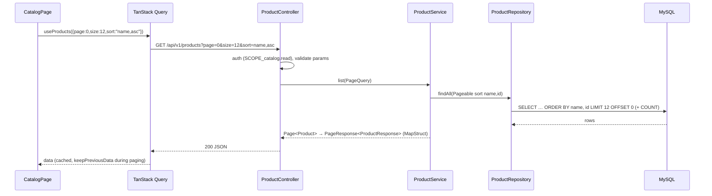
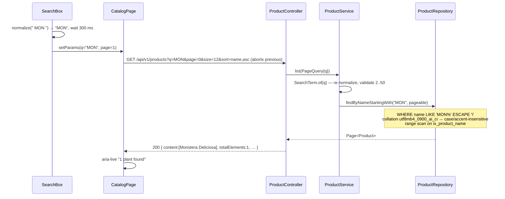
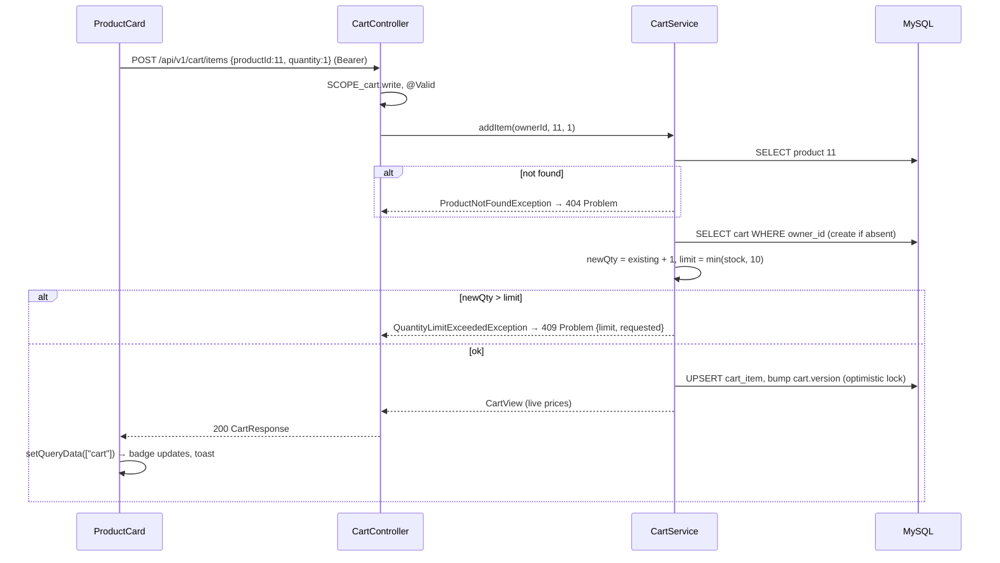

# 03 — Architecture

> Related: [04 backend](04-backend-design.md) · [05 frontend](05-frontend-design.md) · [07 auth](07-auth-design.md) · [08 docker](08-docker-and-environments.md)
> ADRs: [002](adr/002-github-oauth-direct-token.md), [003](adr/003-local-authorization-server-dev-e2e.md), [007](adr/007-cross-origin-cors-topology.md), [008](adr/008-layered-package-by-feature.md)

## 1. System context



## 2. Containers



| Container | Responsibility | Tech |
|---|---|---|
| frontend | Serve built SPA, generate `/config.json` from env at start, security headers, SPA fallback | React 19, TS, Vite, nginx |
| backend | REST API (catalog, cart, me), token exchange proxy, token validation, Local AS (dev/e2e), OpenAPI + Swagger UI, Flyway, Actuator | Spring Boot 4, Security 7 (incl. Authorization Server), JPA |
| mysql | Persistent storage of catalog and carts | MySQL 8.4 LTS, utf8mb4 |
| GitHub (external) | Identity provider in prod | OAuth App |

## 3. Backend components



Responsibilities and rules are detailed in [04 §1–3](04-backend-design.md#1-package-structure).

## 4. Sequence diagrams

### 4.1 Login — prod (GitHub, direct token)



### 4.2 Login — dev/e2e (Local AS)



### 4.3 List products



### 4.4 Search



### 4.5 Add to cart



## 5. Folder structures

### 5.1 Repository root

```text
/
├── backend/                 # Spring Boot service (own pom, Dockerfile, README)
├── frontend/                # React SPA (own package.json, Dockerfile, README)
├── docs/
│   ├── plan/                # this plan (00–12, adr/ = the project's ADRs, decision-log.md)
│   ├── api/openapi.yaml     # committed OpenAPI snapshot (contract source of truth)
│   ├── architecture.md      # living architecture doc (derived from 03 at M7)
│   ├── security.md          # ASVS L1 checklist (M7)
│   └── runbook.md
├── compose.yaml             # full stack
├── compose.e2e.yaml         # e2e overrides (profile, fixtures, Playwright base URL)
├── .env.example             # documented env vars; .env is git-ignored
├── .github/workflows/ci.yml · .github/dependabot.yml · .github/pull_request_template.md
├── .editorconfig · .gitattributes · .gitignore
└── README.md
```

### 5.2 `backend/`

```text
backend/
├── pom.xml · mvnw · .mvn/ · Dockerfile · .dockerignore · README.md
├── config/checkstyle/checkstyle.xml · config/spotbugs/exclude.xml
└── src/
    ├── main/java/com/plantshop/
    │   ├── PlantShopApplication.java
    │   ├── catalog/   api/ (ProductController, dto/) · service/ · domain/ · repository/ · mapper/
    │   ├── cart/      api/ · service/ · domain/ · repository/ · mapper/ · exception/
    │   ├── auth/      api/ (TokenExchangeController, MeController) · github/ · local/ (@Profile dev|e2e) · security/
    │   └── common/    error/ · web/ (PageResponse, RequestIdFilter, RateLimitFilter) · config/ (OpenApiConfig, ClockConfig)
    ├── main/resources/
    │   ├── application.yml · application-dev.yml · application-e2e.yml · application-prod.yml
    │   ├── db/migration/V1__…sql …        # all environments
    │   └── db/e2e/R__e2e_fixtures.sql      # e2e profile only
    ├── test/java/com/plantshop/…           # *Test.java = unit/slice (Surefire); *IT.java = integration (Failsafe)
    │   └── support/ (MySqlContainerConfig, GitHubWireMock, TestTokens, builders)
    └── test/resources/ (wiremock/github/*.json, fixtures/*.sql)
```

### 5.3 `frontend/`

```text
frontend/
├── package.json · package-lock.json · vite.config.ts · vitest.config.ts · playwright.config.ts
├── tsconfig.json · tsconfig.app.json · tsconfig.node.json · eslint.config.js · .prettierrc.json
├── index.html · Dockerfile · .dockerignore · README.md
├── nginx/ default.conf.template · config.json.template · 40-write-config.sh
├── public/ config.json (dev) · images/plants/*.svg · favicon.svg
├── e2e/ specs/*.spec.ts · fixtures/ (auth.ts, api.ts) · pages/ (page objects)
├── scripts/ check-bundle-size.mjs
└── src/
    ├── main.tsx · App.tsx · router.tsx · styles/index.css
    ├── config/ loadConfig.ts
    ├── api/ client.ts · problem.ts · schema.d.ts (generated from docs/api/openapi.yaml) · products.ts · cart.ts · me.ts
    ├── auth/ AuthProvider.tsx · oauth.ts · pkce.ts · RequireAuth.tsx · CallbackPage.tsx · LoginPage.tsx
    ├── features/catalog/ CatalogPage · ProductGrid · ProductCard · SortSelect · SearchBox · Pagination · useCatalogParams.ts
    ├── features/cart/ CartPage · CartLine · QuantityStepper · CartBadge · useCart.ts
    ├── components/ui/ Button · Alert · Toast · Skeleton · EmptyState · ErrorState · Spinner
    ├── components/layout/ AppShell · Header · UserMenu · SkipLink
    ├── lib/ formatPrice.ts · normalizeQuery.ts
    └── test/ setup.ts · msw/ (handlers.ts, server.ts, fixtures.ts) · render.tsx
```

## 6. Cross-cutting concerns

| Concern | Approach | Detail |
|---|---|---|
| Errors | RFC 9457 Problem Details everywhere except `/api/v1/auth/token` (RFC 6749 error JSON for OAuth-client compatibility) | [04 §5](04-backend-design.md#5-error-model) |
| Config | 12-factor env vars; frontend runtime `/config.json` | [08 §4](08-docker-and-environments.md#4-environment-variables) |
| Logging/metrics | ECS JSON logs, Micrometer/Prometheus | [02 §6](02-non-functional-requirements.md#6-observability) |
| API contract | Code-first springdoc → committed `docs/api/openapi.yaml` → TS types | [11 §4](11-documentation-plan.md#4-openapi--swagger-conventions) |
| Time | Injected `Clock` bean (testable) | [10](10-code-quality-and-conventions.md) |
