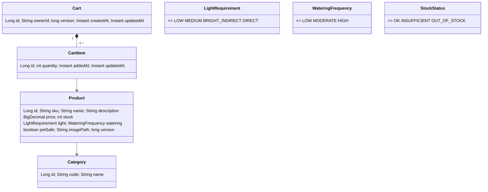

# 04 — Backend Design

> Related: [01 rules](01-functional-requirements.md#3-business-rules) · [03 components](03-architecture.md#3-backend-components) · [06 data](06-data-model-and-migrations.md) · [07 auth](07-auth-design.md)
> ADRs: [005](adr/005-prefix-search-via-collation.md), [006](adr/006-cart-rules.md), [008](adr/008-layered-package-by-feature.md), [013](adr/013-spring-boot-4-on-java-17.md), [015](adr/015-page-number-pagination.md)

## 1. Package structure

Root package `com.plantshop`, **package-by-feature, layered inside each feature** (D12):

| Package | Contents | May depend on |
|---|---|---|
| `<feature>.api` | `@RestController`s, request/response DTOs (Java `record`s), OpenAPI annotations | `service`, `common` |
| `<feature>.service` | Transactional use cases, business rules, `*View` read models | `domain`, `repository`, other features' **service** only |
| `<feature>.domain` | JPA entities, enums, value objects (`Money`, `SearchTerm`, `Quantity`) | `common` |
| `<feature>.repository` | Spring Data interfaces | `domain` |
| `<feature>.mapper` | MapStruct mappers entity/view → DTO | `domain`, `api` DTOs |
| `common.*` | error handling, web filters, config | — |

ArchUnit rules (CI): no `api → repository`; no `domain → api|service`; controllers never return entities; no cycles between feature packages; `auth.local..` classes annotated `@Profile({"dev","e2e"})`.

## 2. Domain model



Value objects: `SearchTerm` (normalises + validates 2..50, BR-04), `Quantity` (1..10), `LineLimit.of(stock)` = `min(stock, 10)`. Monetary maths in `MoneyMath` (scale 2, `HALF_UP`). Cart read model `CartView`/`CartLineView` computes live line totals and `StockStatus` (BR-09, BR-12).

## 3. Services

**ProductService** — `Page<Product> list(PageQuery)`: if `q` present → `findByNameStartingWith(term, pageable)` else `findAll(pageable)`. Pageable sort is built from whitelist (BR-03) and always appends `id` asc as final tie-breaker. **Never** uses `IgnoreCase` (would wrap `UPPER()` and defeat the index — [ADR-005](adr/005-prefix-search-via-collation.md)). Spring Data escapes `%`/`_` for `StartingWith` (verified by IT, AC-05.7).

**CartService** (`@Transactional`):

- `CartView get(ownerId)` — empty view if no cart (no row created on read).
- `CartView addItem(ownerId, productId, qty)` — lock-free optimistic: load/create cart, merge line, check `LineLimit`, save; on `ObjectOptimisticLockingFailureException` retry once, then 409 `concurrent-modification`.
- `CartView updateQuantity(ownerId, productId, qty)` — line must exist (404 `cart-item-not-found`); decrement always allowed down to 1; increments checked against limit.
- `CartView removeItem(ownerId, productId)` — 404 if absent.

**MeService** — maps the authenticated principal to `MeResponse`.

## 4. REST API contract

Base path `/api/v1`, JSON (`application/json`), errors `application/problem+json`. All endpoints require Bearer auth unless noted. Full schema = generated OpenAPI ([11 §4](11-documentation-plan.md#4-openapi--swagger-conventions)).

| Method & path | Auth | Request | Success | Errors |
|---|---|---|---|---|
| `GET /products` | `SCOPE_catalog.read` | query `page` (≥0, default 0), `size` (1–48, default 12), `sort` (`name,asc`·`name,desc`·`price,asc`·`price,desc`, default `name,asc`), `q` (optional, 2–50 after normalisation) | 200 `PageResponse<ProductResponse>` | 400, 401, 403 |
| `GET /cart` | `SCOPE_cart.read` | — | 200 `CartResponse` | 401, 403 |
| `POST /cart/items` | `SCOPE_cart.write` | `{ "productId": 11, "quantity": 1 }` (quantity 1–10, default 1) | 200 `CartResponse` | 400, 401, 403, 404 `product-not-found`, 409 `quantity-limit-exceeded` / `out-of-stock` / `concurrent-modification` |
| `PATCH /cart/items/{productId}` | `SCOPE_cart.write` | `{ "quantity": 3 }` (1–10) | 200 `CartResponse` | 400, 401, 403, 404 `cart-item-not-found`, 409 |
| `DELETE /cart/items/{productId}` | `SCOPE_cart.write` | — | 200 `CartResponse` | 401, 403, 404 |
| `GET /me` | authenticated | — | 200 `MeResponse` | 401 |
| `POST /auth/token` | **public**, rate-limited | `application/x-www-form-urlencoded`: `grant_type=authorization_code`, `code`, `redirect_uri`, `client_id`, `code_verifier` | 200 `{ access_token, token_type, scope }` | 400 `{error:"invalid_request"\|"invalid_grant"\|"invalid_client"}` (RFC 6749 §5.2), 429, 502 |

Notes: cart mutations return the whole cart so the SPA can update the badge and totals from one response. `POST` returns 200 (not 201) because it may update an existing line rather than create a resource. `/auth/token` exists only when `app.auth.mode=github` (prod, or opt-in elsewhere).

### 4.1 Schemas (examples)

```json
// PageResponse<ProductResponse>
{
  "content": [{
    "id": 11, "sku": "FRN-BIRDNEST", "name": "Bird's Nest Fern",
    "description": "Glossy, wavy fronds…", "price": "26.99", "currency": "USD",
    "stock": 3, "category": { "code": "FERNS", "name": "Ferns" },
    "light": "MEDIUM", "watering": "HIGH", "petSafe": true,
    "imagePath": "/images/plants/frn-birdnest.svg"
  }],
  "page": 0, "size": 12, "totalElements": 28, "totalPages": 3,
  "sort": "name,asc", "query": null
}
```

```json
// CartResponse
{
  "items": [{
    "productId": 11, "name": "Bird's Nest Fern", "imagePath": "/images/plants/frn-birdnest.svg",
    "unitPrice": "26.99", "quantity": 2, "lineTotal": "53.98",
    "stock": 3, "maxQuantity": 3, "stockStatus": "OK"
  }],
  "itemCount": 2, "subtotal": "53.98", "currency": "USD"
}
```

```json
// MeResponse
{ "ownerId": "github:583231", "displayName": "Octo Cat", "avatarUrl": "https://avatars.githubusercontent.com/u/583231", "provider": "github" }
```

Money is serialised as a **string** with 2 decimals to avoid float rounding in JS (`@JsonFormat(shape = STRING)`); the SPA formats via `Intl` without arithmetic (totals come from the server).

## 5. Error model

RFC 9457 Problem Details via Spring's `ProblemDetail` + `@RestControllerAdvice GlobalExceptionHandler extends ResponseEntityExceptionHandler`; `spring.mvc.problemdetails.enabled=true`. Security 401/403 produced by custom `AuthenticationEntryPoint`/`AccessDeniedHandler` in the same format.

```json
{
  "type": "https://plantshop.example/problems/quantity-limit-exceeded",
  "title": "Quantity limit exceeded",
  "status": 409,
  "detail": "You can have at most 3 of Bird's Nest Fern in your cart.",
  "instance": "/api/v1/cart/items",
  "code": "quantity-limit-exceeded",
  "limit": 3, "requested": 4, "productId": 11,
  "traceId": "6f1c…"
}
```

`traceId` is added together with request/trace ids in M3; until then problems carry every other member shown above.

| `code` | Status | When |
|---|---|---|
| `validation-failed` | 400 | Bean Validation; body has `errors: [{field, message, rejectedValue}]` |
| `malformed-request` | 400 | Unparseable JSON, type mismatch |
| `invalid-search-term` | 400 | `q` outside 2–50 after normalisation |
| `unauthenticated` | 401 | Missing/invalid/expired token (`WWW-Authenticate: Bearer error="invalid_token"`) |
| `forbidden` | 403 | Missing scope |
| `product-not-found` / `cart-item-not-found` | 404 | — |
| `out-of-stock` / `quantity-limit-exceeded` / `concurrent-modification` | 409 | BR-08, edge cases |
| `rate-limited` | 429 | `Retry-After` header |
| `auth-provider-unavailable` | 503 | GitHub check failed/timed out on cache miss; `Retry-After: 30` |
| `internal-error` | 500 | Unexpected; generic detail, full stack trace in logs only |

`type` URIs are stable identifiers documented in OpenAPI (they need not resolve). `detail` is user-safe and displayed by the SPA verbatim for 4xx.

## 6. Validation

- Request DTO records annotated with Jakarta Validation (`@NotNull @Positive Long productId`, `@Min(1) @Max(10) Integer quantity`). Controller params `@Validated` (`@Min(0) page`, `@Min(1) @Max(48) size`, sort parsed via `SortParam` converter → 400 on unknown).
- Business invariants (stock limits) live in services/value objects, not annotations.
- DB constraints (CHECK, FK, UNIQUE) are the last line of defence ([06](06-data-model-and-migrations.md)).

## 7. Security configuration

Ordered `SecurityFilterChain`s:

1. **@Order(1) Local AS chain** (`@Profile({"dev","e2e"})`): `OAuth2AuthorizationServerConfigurer` endpoints, form login (`/login`), session-based, CSRF on, CORS for `/oauth2/token`.
2. **@Order(2) API chain** (`/api/**`): stateless, CSRF off (bearer only, no cookies), CORS from `app.cors.allowed-origins`, `oauth2ResourceServer(o -> o.authenticationManagerResolver(tokenResolver))`, `authorizeHttpRequests` per §4, `/api/v1/auth/token` permitAll + `RateLimitFilter`.
3. **@Order(3) Docs/infra chain**: `/v3/api-docs/**`, `/swagger-ui/**` permitAll **only if** `app.swagger.enabled` (else not mapped → 404); everything else denied.

Management (Actuator) runs on port 8081 with its own chain: `health/**` permitAll, `prometheus`, `info` permitAll on internal network only (port not published in prod).

`TokenAuthenticationManagerResolver`: if mode includes `local` **and** the token is a JWT whose `iss` equals the local issuer → `JwtAuthenticationProvider` (in-process `JWKSource`, no HTTP); else if mode includes `github` → `OpaqueTokenAuthenticationProvider(GitHubTokenIntrospector)`; else 401.

## 8. Configuration properties (`@ConfigurationProperties`, validated)

| Prefix | Keys |
|---|---|
| `app.auth` | `mode` (`github` · `local` · `github,local`), `local.issuer`, `local.users[]` (username, password `{bcrypt}`/`{noop}` dev-only, scopes), `local.clients[]` (id, redirect-uris) |
| `app.github` | `client-id`, `client-secret`, `allowed-redirect-uris[]`, `api-base-url` (default `https://api.github.com`), `oauth-base-url` (default `https://github.com`), `token-cache-ttl` (5m), `connect-timeout` (2s), `read-timeout` (3s) |
| `app.cors` | `allowed-origins[]` |
| `app.rate-limit.token-exchange` | `capacity` (10), `refill-period` (1m) |
| `app.swagger` | `enabled` |

Base URLs are configurable so WireMock replaces GitHub in tests.

## 9. Persistence settings

`spring.jpa.hibernate.ddl-auto=validate`, `spring.jpa.open-in-view=false`, `spring.flyway.enabled=true`, `spring.flyway.locations=classpath:db/migration` (+ `classpath:db/e2e` in `e2e`), `spring.flyway.clean-disabled=true`, Hikari pool 10. N+1 avoided with `@EntityGraph` on cart → items → product.

## 10. Logging

SLF4J; `RequestIdFilter` puts `requestId` in MDC and response header; owner ID logged as SHA-256 prefix (8 chars). `Authorization` header and `access_token`/`client_secret`/`code`/`code_verifier` values never logged (custom `TokenMaskingConverter` tested by log-capture test).
