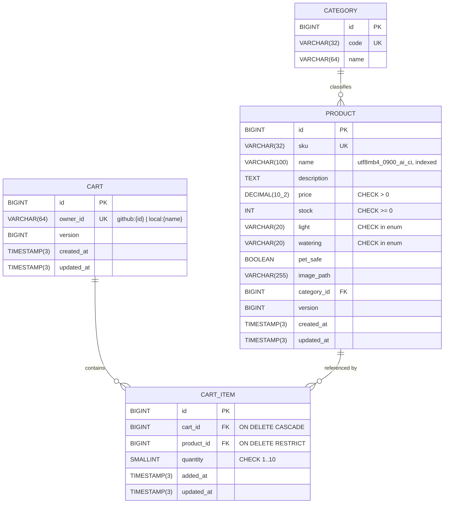

# 06 — Data Model & Migrations

> Related: [04 domain](04-backend-design.md#2-domain-model) · [09 test data](09-testing-strategy.md#5-test-data-strategy)
> ADRs: [005](adr/005-prefix-search-via-collation.md), [009](adr/009-flyway-forward-only-migrations.md)

## 1. ERD

No `users` table: identity is external; `cart.owner_id` is the only user reference (privacy, [02 §7](02-non-functional-requirements.md#7-privacy--compliance)).

## 2. Engine, charset, collation

- MySQL **8.4 LTS**, InnoDB. Server started with `--character-set-server=utf8mb4 --collation-server=utf8mb4_0900_ai_ci`.
- Every `CREATE TABLE` also states `DEFAULT CHARSET=utf8mb4 COLLATE=utf8mb4_0900_ai_ci` explicitly (does not rely on server defaults).
- `product.name` is `utf8mb4_0900_ai_ci`: **a**ccent-**i**nsensitive, **c**ase-**i**nsensitive → `LIKE 'mon%'` matches `Monstera`, `MONSTERA`, `Mönstera`. This *is* the case-insensitive search implementation (D9).
- `sku`, `category.code`, `cart.owner_id` use `utf8mb4_bin` (identifiers must be exact).
- Enums stored as `VARCHAR` + `CHECK` (not MySQL `ENUM`) so adding a value is a cheap migration and JPA `@Enumerated(STRING)` maps directly.
- JDBC URL: `jdbc:mysql://mysql:3306/plantshop?useUnicode=true&characterEncoding=UTF-8&connectionTimeZone=UTC&forceConnectionTimeZoneToSession=true`.

## 3. Indexes

| Table | Index | Purpose |
|---|---|---|
| category | `uk_category_code (code)` | lookup |
| product | `uk_product_sku (sku)` | identity for seeds/fixtures |
| product | `ix_product_name (name, id)` | prefix search **range scan** + sort by name with id tie-breaker |
| product | `ix_product_price (price, name, id)` | price sort |
| product | `ix_product_category (category_id)` | FK |
| cart | `uk_cart_owner (owner_id)` | one cart per owner |
| cart_item | `uk_cart_item_cart_product (cart_id, product_id)` | no duplicate lines (BR-07) |
| cart_item | `ix_cart_item_product (product_id)` | FK RESTRICT checks |

**Search performance rationale**: `name LIKE 'term%'` is sargable → B-tree range on `ix_product_name`; collation makes comparisons case/accent-insensitive *without* `LOWER()`/`UPPER()` (function on column would force a full scan; a functional index would be needed). Verified by an IT that loads 5,000 synthetic rows and asserts `EXPLAIN` `type=range`, `key=ix_product_name` (NFR-PERF-04). At 28 rows the optimizer may legitimately choose a table scan — that is fine and why the test seeds more rows.

## 4. Flyway strategy

| Rule | Value |
|---|---|
| Location (all envs) | `classpath:db/migration` |
| Location (e2e only) | + `classpath:db/e2e` |
| Versioned naming | `V{n}__{snake_case_description}.sql`, `n` = integer, monotonically increasing, no gaps reused |
| Repeatable naming | `R__{description}.sql` (only e2e fixtures) |
| Applied files | **Immutable** (checksum validated on startup, `validateOnMigrate=true`) |
| Rollback | **Forward-only**: corrections are new `V` files; no `U` undo scripts. Local reset = drop volume ([08 §9](08-docker-and-environments.md#9-common-commands)) |
| Baseline | Not used (greenfield); `baselineOnMigrate=false` |
| `clean` | Disabled everywhere (`cleanDisabled=true`); tests use fresh containers instead |
| Hibernate | `ddl-auto=validate` — schema drift fails startup and `@DataJpaTest` |
| Out-of-order | `false` |
| Review | Every migration PR includes the `EXPLAIN`/constraint rationale in its description |

### 4.1 Migration plan

| File | Content |
|---|---|
| `V1__create_category_table.sql` | `category` + `uk_category_code` |
| `V2__create_product_table.sql` | `product` + CHECKs, FK, indexes |
| `V3__create_cart_tables.sql` | `cart`, `cart_item` + CHECKs, FKs, unique keys |
| `V4__seed_categories.sql` | 6 categories |
| `V5__seed_products.sql` | 28 products (§5), inserted with explicit `sku`, category by `code` sub-select |
| `db/e2e/R__e2e_fixtures.sql` | Pins stock of the SKUs E2E specs depend on (`FRN-BIRDNEST`=3, `FRN-MAIDENHAIR`=0, `TRL-SPIDER`=50), so later seed edits can't silently break E2E. Idempotent `UPDATE … WHERE sku IN (…)`. |

## 5. Seed catalog (V5)

Categories (V4): `FOLIAGE` Foliage · `TRAILING` Trailing & Climbing · `FERNS` Ferns · `PALMS` Palms · `SUCCULENTS` Succulents & Cacti · `FLOWERING` Flowering.

Pet safety follows commonly published ASPCA toxicity listings. Image path = `/images/plants/{sku lower-case}.svg`.

| # | SKU | Name | Category | Price | Stock | Light | Watering | Pet-safe |
|---|---|---|---|---|---|---|---|---|
| 1 | FOL-MONSTERA | Monstera Deliciosa | FOLIAGE | 39.99 | 14 | BRIGHT_INDIRECT | MODERATE | No |
| 2 | TRL-ADANSONII | Swiss Cheese Monstera | TRAILING | 24.99 | 9 | BRIGHT_INDIRECT | MODERATE | No |
| 3 | FOL-SNAKE | Snake Plant 'Laurentii' | FOLIAGE | 29.99 | 22 | LOW | LOW | No |
| 4 | FOL-ZZ | ZZ Plant | FOLIAGE | 34.99 | 18 | LOW | LOW | No |
| 5 | TRL-POTHOS | Golden Pothos | TRAILING | 14.99 | 40 | LOW | MODERATE | No |
| 6 | TRL-PHILO | Heartleaf Philodendron | TRAILING | 16.99 | 25 | MEDIUM | MODERATE | No |
| 7 | FOL-FIDDLE | Fiddle Leaf Fig | FOLIAGE | 59.99 | 6 | BRIGHT_INDIRECT | MODERATE | No |
| 8 | FOL-RUBBER | Rubber Plant 'Burgundy' | FOLIAGE | 32.00 | 11 | BRIGHT_INDIRECT | MODERATE | No |
| 9 | FLW-PEACELILY | Peace Lily | FLOWERING | 27.50 | 15 | LOW | HIGH | No |
| 10 | FRN-BOSTON | Boston Fern | FERNS | 22.99 | 12 | MEDIUM | HIGH | Yes |
| 11 | FRN-BIRDNEST | Bird's Nest Fern | FERNS | 26.99 | 3 | MEDIUM | HIGH | Yes |
| 12 | FRN-MAIDENHAIR | Maidenhair Fern | FERNS | 19.99 | 0 | MEDIUM | HIGH | Yes |
| 13 | TRL-SPIDER | Spider Plant | TRAILING | 12.99 | 50 | MEDIUM | MODERATE | Yes |
| 14 | PLM-PARLOR | Parlor Palm | PALMS | 29.99 | 9 | LOW | MODERATE | Yes |
| 15 | PLM-ARECA | Areca Palm | PALMS | 49.99 | 5 | BRIGHT_INDIRECT | MODERATE | Yes |
| 16 | SUC-PONYTAIL | Ponytail Palm | SUCCULENTS | 44.99 | 7 | DIRECT | LOW | Yes |
| 17 | FOL-CALATHEA | Calathea Orbifolia | FOLIAGE | 36.00 | 8 | MEDIUM | HIGH | Yes |
| 18 | FOL-PRAYER | Prayer Plant | FOLIAGE | 18.50 | 20 | MEDIUM | HIGH | Yes |
| 19 | FOL-PILEA | Chinese Money Plant | FOLIAGE | 17.99 | 16 | BRIGHT_INDIRECT | MODERATE | Yes |
| 20 | SUC-ALOE | Aloe Vera | SUCCULENTS | 13.99 | 30 | DIRECT | LOW | No |
| 21 | SUC-JADE | Jade Plant | SUCCULENTS | 21.99 | 13 | DIRECT | LOW | No |
| 22 | SUC-ECHEVERIA | Echeveria 'Lola' | SUCCULENTS | 9.99 | 35 | DIRECT | LOW | Yes |
| 23 | SUC-XMASCACTUS | Christmas Cactus | SUCCULENTS | 19.50 | 10 | BRIGHT_INDIRECT | MODERATE | Yes |
| 24 | FLW-ORCHID | Phalaenopsis Orchid | FLOWERING | 34.99 | 4 | BRIGHT_INDIRECT | LOW | Yes |
| 25 | FLW-ANTHURIUM | Anthurium 'Red' | FLOWERING | 31.99 | 9 | BRIGHT_INDIRECT | MODERATE | No |
| 26 | TRL-PEARLS | String of Pearls | TRAILING | 23.99 | 2 | BRIGHT_INDIRECT | LOW | No |
| 27 | TRL-HOYA | Hoya Carnosa 'Krimson Queen' | TRAILING | 27.99 | 6 | BRIGHT_INDIRECT | LOW | Yes |
| 28 | FLW-BROMELIAD | Bromeliad Guzmania | FLOWERING | 25.00 | 0 | MEDIUM | LOW | Yes |

Test-relevant properties of the seed: 28 rows → 3 pages (12/12/4); stock 0 (#12, #28), low stock 2–4 (#11, #24, #26) for limit tests; prefix trap `Monstera…` vs `Swiss Cheese Monstera` (AC-05.1); several prices share leading digits for sort tests; apostrophes/quotes in names exercise escaping. Descriptions (2–3 sentences, 150–300 chars) are written in V5 and reviewed in M1.

## 6. Seed & data handling per environment

| Env | Catalog | Carts | Extra |
|---|---|---|---|
| dev (local apps) | V4/V5 | persisted in `mysql-data` volume | — |
| e2e (compose) | V4/V5 | fresh volume per CI run (`down -v`); each Playwright test empties its worker user's cart **through the public API** in `beforeEach` | `db/e2e` fixtures pin stock values the specs rely on. The app never mutates stock (no checkout), so no reset endpoint is needed |
| prod | V4/V5 | persisted | — |
| tests (Testcontainers) | V4/V5 | per test class via `@Sql` cleanup | `src/test/resources/fixtures/*.sql` (e.g. accented names, 5k rows) |
