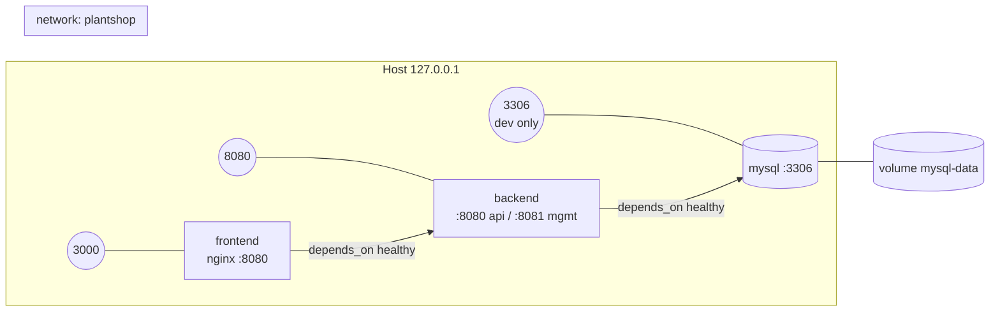

# 08 — Docker & Environments

> Related: [03 containers](03-architecture.md#2-containers) · [07 auth modes](07-auth-design.md#1-modes) · [09 E2E](09-testing-strategy.md#4-frontend-tests) · [10 CI](10-code-quality-and-conventions.md#8-ci-quality-gates)
> ADRs: [007](adr/007-cross-origin-cors-topology.md), [012](adr/012-runtime-frontend-config.md)

## 1. Topology



## 2. Dockerfiles

### 2.1 Backend Dockerfile

- **Stage `build`**: `eclipse-temurin:17-jdk-noble`; copy `mvnw`, `.mvn`, `pom.xml` first → `./mvnw -B dependency:go-offline` (BuildKit cache mount `~/.m2`); copy `src` → `./mvnw -B -DskipTests package` (tests run in CI jobs, not in image build); extract layers with `java -Djarmode=tools -jar app.jar extract --layers --launcher`.
- **Stage `runtime`**: `eclipse-temurin:17-jre-noble`; create user `app` (uid/gid 10001); copy layers (dependencies → spring-boot-loader → snapshot-dependencies → application) for cache-friendly rebuilds; ensure `curl` is available for the healthcheck (install with `--no-install-recommends` if absent); `USER 10001`; `EXPOSE 8080 8081`; `ENV JAVA_TOOL_OPTIONS="-XX:MaxRAMPercentage=75 -XX:+ExitOnOutOfMemoryError"`; `ENTRYPOINT ["java","org.springframework.boot.loader.launch.JarLauncher"]`.
- Labels: `org.opencontainers.image.{source,revision,version,created}` from build args.
- *Distroless considered and rejected for now:* no shell/curl for compose healthchecks; revisit during prod hardening.

### 2.2 Frontend Dockerfile

- **Stage `build`**: `node:24-alpine`; `npm ci` (cache mount); `npm run build` → `dist/`.
- **Stage `runtime`**: `nginxinc/nginx-unprivileged:stable-alpine` (runs as uid 101, listens 8080); copy `dist/` to `/usr/share/nginx/html`; copy `nginx/default.conf.template` (envsubst'd by the image's entrypoint) and `nginx/40-write-config.sh` into `/docker-entrypoint.d/` — writes `/usr/share/nginx/html/config.json` from env (`API_BASE_URL`, `AUTH_*`) at container start, failing fast if a required var is missing ([ADR-012](adr/012-runtime-frontend-config.md)).
- nginx config: SPA fallback `try_files $uri /index.html`; `Cache-Control: public, max-age=31536000, immutable` for hashed `/assets/*`; `no-store` for `index.html` and `config.json`; gzip; security headers (NFR-SEC-10) with `API_ORIGIN` substituted into CSP; `/healthz` returns 200 `ok`.
- Writable paths limited to `/tmp` and the html dir for `config.json` (read-only root FS considered for prod).

### 2.3 `.dockerignore`

Both services exclude `target/`, `node_modules/`, `dist/`, `coverage/`, `.git`, `.env*`, IDE folders, test reports.

## 3. Compose (`compose.yaml`)

| Service | Image / build | Ports (host:container) | Healthcheck | depends_on | Limits |
|---|---|---|---|---|---|
| `mysql` | `mysql:8.4` | `127.0.0.1:3306:3306` | `mysqladmin ping -h 127.0.0.1 -u$$MYSQL_USER -p$$MYSQL_PASSWORD` every 5 s, 20 retries, start_period 20 s | — | 1 GiB mem |
| `backend` | build `./backend` → `plantshop/backend:${IMAGE_TAG:-local}` | `127.0.0.1:8080:8080` (8081 not published) | `curl -fsS http://127.0.0.1:8081/actuator/health/readiness` every 10 s, start_period 60 s | mysql: healthy | 768 MiB, 1.5 CPU |
| `frontend` | build `./frontend` → `plantshop/frontend:${IMAGE_TAG:-local}` | `127.0.0.1:3000:8080` | `wget -qO- http://127.0.0.1:8080/healthz` every 10 s | backend: healthy | 128 MiB, 0.5 CPU |

- MySQL command: `--character-set-server=utf8mb4 --collation-server=utf8mb4_0900_ai_ci`.
- Named volume `mysql-data`; network `plantshop`; `restart: unless-stopped`; `init: true` for backend.
- Ports bound to `127.0.0.1` (not `0.0.0.0`) to avoid exposing a dev DB on the LAN.
- `env_file: .env` optional (`required: false`) so `docker compose up` works from a clean checkout using defaults in `compose.yaml` (`${VAR:-default}`) → **profile `e2e`, auth mode `local`** (assumption 5 in [00](00-overview.md#5-assumptions)).
- `compose.e2e.yaml` override: pins `SPRING_PROFILES_ACTIVE=e2e`, disables MySQL host port, sets `IMAGE_TAG`, used by CI with `docker compose -f compose.yaml -f compose.e2e.yaml up -d --build --wait`.
- GitHub mode locally: set `SPRING_PROFILES_ACTIVE=prod`, `GITHUB_CLIENT_ID`, `GITHUB_CLIENT_SECRET`, `AUTH_PROVIDER=github` etc. in `.env` (documented in runbook).

## 4. Environment variables

### 4.1 Backend

| Variable | Default (compose) | Required in prod | Description |
|---|---|---|---|
| `SPRING_PROFILES_ACTIVE` | `e2e` | ✔ (`prod`) | Profile ([§5](#5-profiles)) |
| `DB_URL` | `jdbc:mysql://mysql:3306/plantshop?…` | ✔ | JDBC URL |
| `DB_USERNAME` / `DB_PASSWORD` | `plantshop` / `plantshop-dev` | ✔ | App DB user |
| `APP_AUTH_MODE` | from profile (`dev`/`e2e`: `local`, otherwise `github`) | | `github` · `local` · `github,local`; not passed by compose (an empty value would override the profile default) |
| `APP_AUTH_LOCAL_ISSUER` | `http://127.0.0.1:8080` | — | Local AS issuer |
| `APP_AUTH_LOCAL_SPA_REDIRECT_URI` | `http://127.0.0.1:3000/auth/callback` | — | Local client redirect |
| `APP_LOCAL_USER_PASSWORD` | `plants-dev-only` | — (rejected in prod) | Password for all in-memory users |
| `GITHUB_CLIENT_ID` | — | ✔ (github mode) | OAuth App client id |
| `GITHUB_CLIENT_SECRET` | — | ✔ (github mode) | **Secret**; never logged |
| `APP_GITHUB_ALLOWED_REDIRECT_URIS` | `http://127.0.0.1:3000/auth/callback,http://127.0.0.1:8080/swagger-ui/oauth2-redirect.html` | ✔ | Proxy allowlist |
| `APP_CORS_ALLOWED_ORIGINS` | `http://127.0.0.1:3000` | ✔ | Comma-separated exact origins |
| `APP_SWAGGER_ENABLED` | `true` (dev/e2e), `false` (prod) | | Swagger UI + `/v3/api-docs` |
| `APP_RATE_LIMIT_TOKEN_EXCHANGE_CAPACITY` | `10` | | per IP per minute |
| `LOGGING_STRUCTURED_FORMAT_CONSOLE` | `ecs` (e2e/prod) | | JSON logs |
| `SERVER_PORT` / `MANAGEMENT_SERVER_PORT` | `8080` / `8081` | | |
| `JAVA_TOOL_OPTIONS` | image default | | JVM flags |

### 4.2 Frontend (container runtime → `config.json`)

| Variable | Default (compose) | Description |
|---|---|---|
| `API_BASE_URL` | `http://127.0.0.1:8080/api/v1` | API root (browser-visible) |
| `API_ORIGIN` | `http://127.0.0.1:8080` | Used in CSP `connect-src` |
| `AUTH_PROVIDER` | `local` | `local` · `github` |
| `AUTH_AUTHORIZE_URL` | `http://127.0.0.1:8080/oauth2/authorize` | |
| `AUTH_TOKEN_URL` | `http://127.0.0.1:8080/oauth2/token` | github: `…/api/v1/auth/token` |
| `AUTH_LOGOUT_URL` | `http://127.0.0.1:8080/connect/logout` | empty in github mode |
| `AUTH_CLIENT_ID` | `plant-spa` | github: OAuth App client id (public value) |
| `AUTH_SCOPE` | `openid catalog.read cart.read cart.write` | github: `read:user` |
| `AUTH_REDIRECT_URI` | `http://127.0.0.1:3000/auth/callback` | |

### 4.3 MySQL

`MYSQL_DATABASE=plantshop`, `MYSQL_USER=plantshop`, `MYSQL_PASSWORD`, `MYSQL_ROOT_PASSWORD` (dev defaults in `compose.yaml`; must be overridden outside local).

## 5. Profiles

| Profile | Used by | Auth mode | Swagger | Logs | Flyway locations | Notes |
|---|---|---|---|---|---|---|
| `dev` | Local `./mvnw spring-boot:run` against compose MySQL | `local` (opt-in `github,local`) | on | plain, DEBUG for `com.plantshop` | migration | devtools on classpath (optional dep) |
| `e2e` | `docker compose up` (default), CI E2E | `local` | on | JSON | migration + e2e | e2e-user-1..4 |
| `prod` | Real deployments; local GitHub testing | `github` | off unless `APP_SWAGGER_ENABLED=true` | JSON | migration | Startup guard rejects local mode/default passwords |
| *(none)* | Tests | per test | per test | plain | migration | Testcontainers `@ServiceConnection` |

## 6. Secrets handling

- `.env` is git-ignored; `.env.example` documents every variable with safe dev defaults and **no real secrets**.
- Secrets reach containers via env only; nothing is baked into images (CI step greps image history for `GITHUB_CLIENT_SECRET`).
- For real prod, the runbook recommends orchestrator secrets / Docker secrets mounted as files with Spring `configtree:` import (supported by config, not exercised in compose).
- CI uses no GitHub OAuth secrets (E2E runs in local mode).

## 7. Dev hot-reload loop (D15)

```bash
docker compose up -d mysql                     # DB only
cd backend && ./mvnw spring-boot:run -Dspring-boot.run.profiles=dev   # devtools restart
cd frontend && npm run dev                     # Vite HMR on 127.0.0.1:3000
```

## 8. Image tagging & CI usage

`IMAGE_TAG` = short git SHA in CI (`plantshop/backend:3f2a9c1`), `local` otherwise. Images are built in CI and used for the E2E job but **not pushed** (D16). Base images pinned by tag in Dockerfiles; Dependabot (docker ecosystem) proposes updates.

## 9. Common commands

| Task | Command |
|---|---|
| Start full stack | `docker compose up -d --build --wait` |
| Logs | `docker compose logs -f backend` |
| Reset DB | `docker compose down -v && docker compose up -d --wait` |
| DB shell | `docker compose exec mysql mysql -uplantshop -p plantshop` |
| E2E stack | `docker compose -f compose.yaml -f compose.e2e.yaml up -d --build --wait` |
| Stop | `docker compose down` |
