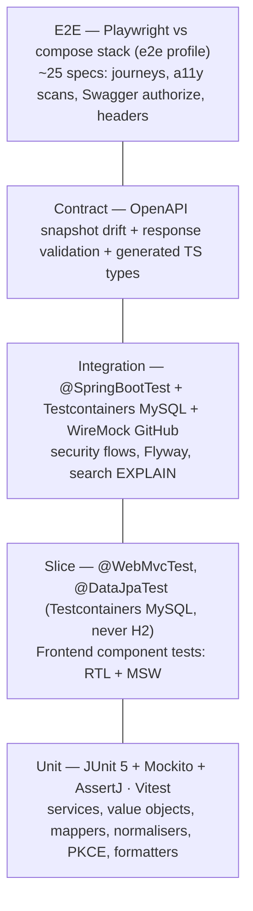

# 09 — Testing Strategy

> Testing is the top priority. Every requirement in [01](01-functional-requirements.md) and [02](02-non-functional-requirements.md) maps to automated tests ([§8](#8-traceability-matrix)).
> ADR: [011](adr/011-testing-strategy.md)

## 1. Pyramid

Target distribution (by count): unit ~55 %, slice/component ~25 %, integration ~12 %, contract ~3 %, E2E ~5 %.

## 2. Tools

| Layer | Backend | Frontend |
|---|---|---|
| Unit | JUnit 5, Mockito, AssertJ | Vitest, `@testing-library/react`, `user-event`, `jest-dom` matchers |
| Slice/Component | `@WebMvcTest` + `spring-security-test` (`jwt()`, `opaqueToken()`), `@DataJpaTest` + Testcontainers | RTL + MSW 2 (node) + `vitest-axe` |
| Integration | `@SpringBootTest(RANDOM_PORT)`, Testcontainers `mysql:8.4` via `@ServiceConnection` (singleton container, reused across IT classes), WireMock (GitHub), RestClient | — |
| Contract | springdoc spec export (OpenAPI 3.0) compared to the committed snapshot; Atlassian `swagger-request-validator-core` 2.x with a small MockMvc adapter (`support/OpenApiContract`) validates IT exchanges against `docs/api/openapi.yaml` (its MockMvc module still targets `javax.servlet`; 3.x needs Java 21). `openapi-diff` breaking-change report: M7 | `openapi-typescript` types → MSW handlers typed against schema (compile-time contract) |
| Architecture | ArchUnit | ESLint `import/no-restricted-paths` boundaries |
| E2E | — | Playwright (Chromium desktop + Pixel 7 emulation), `@axe-core/playwright` |
| Coverage | JaCoCo | Vitest v8 coverage |

## 3. Backend tests

### 3.1 Unit

`SearchTerm` (normalisation vectors shared with frontend via `docs/api/test-vectors/search-normalisation.json`), `LineLimit`, `MoneyMath`, `CartService` (Mockito repos: merge line, limits, stock 0, optimistic-lock retry), `ProductService` (sort whitelist → Pageable), `GitHubTokenIntrospector` (cache hit/miss/negative, error mapping), `TokenExchangeService` (validation, GitHub error JSON mapping), mappers, `GlobalExceptionHandler` mapping, `TokenMaskingConverter`.

### 3.2 Slice

- `@WebMvcTest(ProductController/CartController/MeController/TokenExchangeController)` — status codes, validation messages, Problem Details shape, scope enforcement, JSON money-as-string.
- `@DataJpaTest` on real MySQL (Testcontainers + Flyway, `@AutoConfigureTestDatabase(replace = NONE)`): prefix search case/accent-insensitivity (fixture rows `Crème Test`, `ÉLAN Test`), wildcard escaping, sort tie-breakers, unique/CHECK constraint violations, `@EntityGraph` query count (Hibernate statistics).

### 3.3 Integration (`*IT`)

- Full HTTP flows per user story through `RestClient` on random port with real Flyway schema.
- Flyway: all migrations apply on empty DB; `validate` passes; seed counts (6 categories, 28 products); `db/e2e` applies only in e2e.
- Search `EXPLAIN` with 5k rows → range on `ix_product_name` (NFR-PERF-04).
- Concurrency: 2 threads add same product → final quantity correct or one 409, never duplicate lines.
- Perf smoke (non-gating, NFR-PERF-01).

### 3.4 Security tests

| Test | Expectation |
|---|---|
| Endpoint sweep: every handler mapping without token | 401 Problem + `WWW-Authenticate` (except allowlist) |
| `viewer` JWT on cart endpoints | 403 |
| Expired / wrong-`iss` / wrong-`aud` / bad-signature JWT | 401 |
| GitHub check 200 / 404 / 422 / timeout / 403 rate-limited (WireMock) | 200 / 401 / 401 / 503 / 503 |
| Token cached: 2nd call makes no WireMock request; after TTL (fake `Ticker`) it does | ✔ |
| Token exchange: bad `client_id`, unlisted `redirect_uri`, short `code_verifier`, GitHub `bad_verification_code` | 400 RFC 6749 errors |
| Token exchange 11th call in a minute | 429 + `Retry-After` |
| CORS preflight from allowed origin / disallowed origin | headers present / 403 without CORS headers |
| Local AS full Authorization Code + PKCE flow (MockMvc: authorize → login → code → token) | JWT with expected scopes |
| PKCE missing for `plant-spa` | `invalid_request` |
| `prod` profile context | Local AS beans absent; `/oauth2/authorize` 404; startup fails if `APP_AUTH_MODE=local` |
| Secret/token never logged (OutputCaptureExtension) | ✔ |
| Owner isolation: user A cannot see/modify user B's cart | ✔ |

### 3.5 Contract tests

1. `OpenApiSnapshotIT` fetches `/v3/api-docs.yaml` and compares to `docs/api/openapi.yaml`; CI fails on any difference (run `./mvnw -Pupdate-openapi` to refresh intentionally). `openapi-diff` reports breaking changes in PR summary.
2. Every IT request/response passes `OpenApiInteractionValidator` against the committed spec (catches undocumented fields/status codes).
3. Frontend `npm run gen:api` regenerates `schema.d.ts`; CI fails if it differs from the committed file; `tsc` fails if MSW handlers or client code drift from the spec.

## 4. Frontend tests

- **Unit**: `normalizeQuery` (shared vectors), `formatPrice`, URL ↔ API param mapping, PKCE helpers (`code_challenge` known-answer test from RFC 7636 Appendix B), `returnTo` validation, `loadConfig` validation, `ApiProblem` parsing, `useDebouncedValue` (fake timers).
- **Component** (RTL + MSW, `renderWithProviders` with fake `AuthProvider`): `ProductCard` (fields, disabled out-of-stock, 409 alert), `CatalogPage` (loading/empty/error, paging, sort resets page, search debounce + cancellation + min-length hint, live region text), `Pagination` (aria-current, boundaries), `CartPage` (lines, totals from server, empty state, stock warnings), `QuantityStepper` (limits, revert on 409), remove focus management, `RequireAuth` redirect, `CallbackPage` (state mismatch, error param, success), `Header` badge count. Each component test file includes an `axe` assertion.
- **E2E** (Playwright, `e2e` profile, one in-memory user per worker; `beforeEach` empties cart via API. Tokens are memory-only, so `storageState` can't carry them; instead a worker-scoped fixture performs the Local AS form login once and saves the **AS session cookie** in `storageState`, making every later test's login a silent redirect):
  - `auth.spec`: unauthenticated redirect + returnTo; logout; error/denied path; viewer cannot add (message).
  - `catalog.spec`: 12 cards, 3 pages, URL paging, page=99 clamp, all 4 sorts verified by order.
  - `search.spec`: prefix vs contains trap, case-insensitivity, min length, no-results + clear, combined with sort.
  - `cart.spec`: add, re-add increments, limit 409 for Bird's Nest Fern (stock 3), out-of-stock disabled, update, remove, badge, subtotal.
  - `a11y.spec`: axe scan of catalog, search-empty, cart, cart-empty, login (no serious/critical), keyboard-only journey.
  - `swagger.spec`: Authorize with `swagger-ui` client, call `GET /cart` → 200.
  - `headers.spec`: CSP, Referrer-Policy, nosniff present; `sessionStorage`/`localStorage` contain no token after login.
  - Projects: `chromium-desktop`, `mobile-chromium` (Pixel 7). Retries: 1 in CI (flake is tracked, not hidden — see §7). Trace off by default, on for retry.

## 5. Test data strategy

- **Backend**: Flyway seed is the baseline; tests assert against seed SKUs, never row ids. Additional data via `@Sql` fixture files (`fixtures/accented-names.sql`, `fixtures/bulk-5000-products.sql` generated by a SQL recursive CTE) and Java test-data builders (`aProduct().withStock(0)`). Each IT class cleans `cart`/`cart_item` in `@AfterEach`; catalog mutations happen only in dedicated classes that restore state.
- **Tokens**: `TestTokens.local("shopper", scopes…)` mints JWTs with the test JWK; GitHub tokens are random strings stubbed in WireMock (`wiremock/github/check-token-200.json` etc.).
- **Frontend**: `test/msw/fixtures.ts` built from typed factories (`makeProduct()`, `makeCart()`); default handlers = happy path, per-test overrides for errors.
- **E2E**: seed + `db/e2e` fixtures; users `e2e-user-{workerIndex+1}`; no cross-test state except catalog (read-only).

## 6. Coverage & quality gates

Per decision D17.

| Gate | Threshold | Tool | Exclusions |
|---|---|---|---|
| Backend line / branch | **≥ 85 % / ≥ 75 %** (unit + IT merged) | JaCoCo `check` in `verify` | `*Application`, `*Config` without logic, generated MapStruct impls, DTO records |
| Frontend line / branch | **≥ 80 % / ≥ 70 %** | Vitest v8 | `main.tsx`, `schema.d.ts`, `*.stories`, test utils |
| Story coverage | Each US has ≥ 1 E2E spec and ≥ 1 backend IT | Traceability check script (tags `@US-xx` in test names) | — |
| A11y | 0 serious/critical axe violations | vitest-axe, axe-playwright | — |
| Contract | Spec snapshot + TS types unchanged | CI | — |
| Flakiness | A test that passes only on retry fails the "flaky report" job (non-blocking) and must get an issue within 1 day | Playwright JSON report | — |

## 7. Conventions

- Names: `methodOrBehaviour_condition_expectedResult` (Java), `it('shows an alert when the quantity limit is exceeded')` (TS). Given/When/Then comments in tests over ~10 lines.
- One behaviour per test; AssertJ fluent assertions; no `Thread.sleep` (Awaitility); fixed `Clock`.
- Tag tests with the story/rule id: JUnit `@Tag("US-06")` / `@DisplayName("[US-06][BR-08] …")`; Playwright `test('[US-06] …')`.
- **Test-first** for services, value objects and normalisers; component tests written alongside components.

## 8. Traceability matrix

| Req | Unit | Slice/Component | Integration / Security / Contract | E2E |
|---|---|---|---|---|
| US-01 Sign in | PKCE KAT, returnTo validation, `TokenExchangeService` | `RequireAuth`, `CallbackPage`, `TokenExchangeController` WebMvc | Local AS PKCE flow IT; GitHub exchange + check (WireMock) IT | auth.spec, swagger.spec |
| US-02 Sign out | — | `UserMenu` logout clears cache | Local AS `/logout` IT | auth.spec |
| US-03 Browse | URL↔API mapping | `CatalogPage` states, `Pagination`, `ProductCard` | `ProductsIT` paging, size bounds | catalog.spec |
| US-04 Sort | `ProductService` sort whitelist | `SortSelect` resets page | `ProductsIT` 4 orders + tie-breakers | catalog.spec |
| US-05 Search | `SearchTerm`, `normalizeQuery` (shared vectors) | `SearchBox` debounce/cancel/min-length; `ProductRepository` @DataJpaTest (case, accents, wildcards) | `SearchIT`, `SearchExplainIT` | search.spec |
| US-06 Add | `CartService` merge/limit/out-of-stock/retry | `CartController` WebMvc 404/409; `ProductCard` 409 alert | `CartIT` add flows, concurrency | cart.spec |
| US-07 View | `CartView` totals, stockStatus | `CartPage` states | `CartIT` live price after price change | cart.spec |
| US-08 Update | `CartService.updateQuantity` | `QuantityStepper` | `CartIT` | cart.spec |
| US-09 Remove | `CartService.removeItem` | `CartLine` focus mgmt | `CartIT` 404 | cart.spec |
| BR-01 / NFR-SEC-01 | — | WebMvc 401s | Endpoint sweep IT | auth.spec |
| BR-13 / T11 | `CartService` owner scoping | — | Owner isolation IT | — |
| NFR-SEC-02 | — | WebMvc scopes | viewer IT | auth.spec (viewer) |
| NFR-SEC-03/05 | `TokenMaskingConverter` | — | Log-capture IT | — |
| NFR-SEC-04 | auth storage unit | — | — | headers.spec |
| NFR-SEC-06 | — | — | CORS IT | (implicitly all E2E) |
| NFR-SEC-07 | Introspector | — | Foreign-token IT | — |
| NFR-SEC-08 | — | — | Prod profile IT | — |
| NFR-SEC-09 | Bucket config | — | Rate-limit IT | — |
| NFR-SEC-10 | — | — | — | headers.spec |
| NFR-PERF-04 | — | — | SearchExplainIT | — |
| NFR-PERF-05 | — | — | — | CI bundle script |
| NFR-PERF-07 | `useDebouncedValue` | `SearchBox` | — | — |
| NFR-A11Y-01..06 | — | vitest-axe per component | — | a11y.spec, mobile project |
| NFR-REL-01/02/04 | — | — | Actuator IT, Flyway IT | CI `compose up --wait` |
| NFR-REL-05 | Introspector cache | — | GitHub-down IT | — |
| NFR-OBS-02/04 | — | — | Metrics/requestId IT | — |

## 9. Definition of Done — per feature

1. Acceptance criteria in [01](01-functional-requirements.md) automated at the layers listed in §8, tagged with IDs.
2. All gates in §6 and [10 §8](10-code-quality-and-conventions.md#8-ci-quality-gates) green in CI.
3. OpenAPI snapshot and generated TS types updated and committed; Swagger UI shows the endpoint with examples and error responses.
4. Docs updated (service README, runbook, ADR if a decision changed, this matrix).
5. `docker compose up --wait` from clean checkout passes and the E2E suite is green.
6. PR reviewed and squash-merged with a Conventional Commit title.
