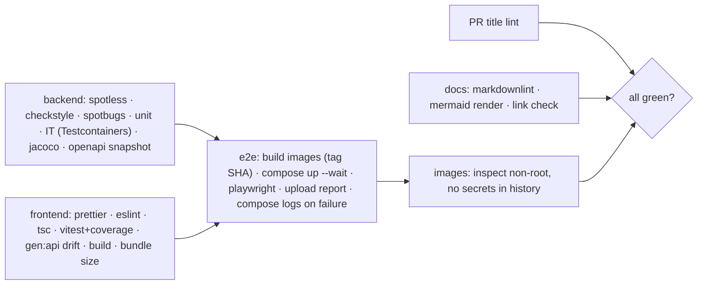

# 10 — Code Quality & Conventions

> Related: [04 packages](04-backend-design.md#1-package-structure) · [05 stack](05-frontend-design.md#1-stack-d11) · [09 gates](09-testing-strategy.md#6-coverage--quality-gates) · [11 docs](11-documentation-plan.md)

## 1. Backend tooling (all run in `./mvnw verify`)

| Tool | Config | Fails build on |
|---|---|---|
| Spotless + google-java-format (GOOGLE style) | `pom.xml`; also formats `pom.xml` (sortpom) and SQL whitespace | any unformatted file (`spotless:check`) |
| Checkstyle | `config/checkstyle/checkstyle.xml` = Google checks minus formatting rules (Spotless owns them) + Javadoc rules below | any violation (severity error) |
| SpotBugs + FindSecBugs | effort max, threshold medium, `config/spotbugs/exclude.xml` (generated code, DTO records `EI_EXPOSE_REP`) | any bug ≥ medium |
| Compiler | `-Xlint:all -Werror`, `-parameters` | warnings |
| ArchUnit | `ArchitectureTest` (layers, cycles, naming, no field injection, no `java.util.Date`, no `System.out`) | rule violation |
| JaCoCo | merged unit+IT report, thresholds in [09 §6](09-testing-strategy.md#6-coverage--quality-gates) | below threshold |
| Maven Enforcer | Java 17, Maven ≥ 3.9, dependency convergence, banned deps (`junit:junit`, `log4j`, H2 in main) | violation |

## 2. Frontend tooling

| Tool | Config | Fails CI on |
|---|---|---|
| TypeScript | `strict`, `noUncheckedIndexedAccess`, `exactOptionalPropertyTypes`, `noImplicitOverride`, `verbatimModuleSyntax` | `tsc --noEmit -b` errors |
| ESLint 10 (flat config) | `typescript-eslint` `strictTypeChecked` + `stylisticTypeChecked`, `react-hooks`, `jsx-a11y` (strict), `testing-library`, `vitest`, core `no-restricted-imports` for boundaries (`features/*` may not import each other; `components/ui` imports nothing from features; chosen over an import plugin to avoid a resolver dependency), `no-restricted-syntax` banning `dangerouslySetInnerHTML`, `localStorage`/`sessionStorage` outside `auth/pkce.ts` | any error; warnings capped at 0 |
| Prettier | `.prettierrc.json` (printWidth 100, singleQuote, trailingComma all) + `prettier-plugin-tailwindcss` | `prettier --check` |
| Bundle budget | `scripts/check-bundle-size.mjs` | > 200 KB gzip JS initial |
| npm | `npm ci`, `engines.node >=24`, lockfile committed, `npm audit --audit-level=high` (report, non-blocking) | — |

## 3. Repository-wide

`.editorconfig` (LF, UTF-8, 2-space indent everywhere, matching google-java-format), `.gitattributes` (`* text=auto eol=lf`, `mvnw` executable), markdownlint-cli2 for `*.md`, `docs/**`, service READMEs (CI; config `.markdownlint-cli2.jsonc`), Mermaid blocks validated by `@mermaid-js/mermaid-cli` in CI docs job, link check (lychee offline mode for relative links).

## 4. Backend conventions

- **Naming**: `*Controller`, `*Service`, `*Repository`, `*Mapper`, `*Request`/`*Response` records, `*View` read models, `*Exception` extends `ApiException(code, status)`; packages lower-case singular feature names.
- **Injection**: constructor only (`final` fields); no `@Autowired` on fields; no Lombok (records + IDE) — keeps generated code out of coverage/SpotBugs noise.
- **Transactions**: on service methods only; `readOnly = true` for queries; no lazy loading outside transactions (`open-in-view=false`).
- **Errors**: throw domain exceptions from services; one `GlobalExceptionHandler`; never return `null` collections; never catch-and-ignore; never expose stack traces or SQL in responses.
- **Validation**: DTO annotations for shape, value objects for invariants (see [04 §6](04-backend-design.md#6-validation)).
- **Time & randomness**: inject `Clock`; `SecureRandom` only through a `RandomProvider` bean for testability.
- **Logging**: SLF4J parameterised messages; levels per [02 NFR-OBS-05](02-non-functional-requirements.md#6-observability); no PII beyond hashed owner id; no tokens.
- **Javadoc**: required on all `public` types and `public` methods in `service`, `domain`, `auth`, `common` packages (Checkstyle `MissingJavadocMethod` scoped); explains *why* and contracts (`@throws` for domain exceptions). Controllers documented via OpenAPI annotations instead.

## 5. Frontend conventions

- **Files**: `PascalCase.tsx` for components (one exported component per file), `camelCase.ts` for modules, tests co-located `*.test.tsx`; feature folders own their hooks.
- **Components**: function components, named exports, props typed with `interface XProps`; no default exports except route lazy chunks.
- **Data**: all server access through `api/*` hooks; components never call `fetch`; query keys defined in one `queryKeys.ts`.
- **Errors**: `ApiProblem` type; UI shows `detail` for 4xx, generic message for 5xx/network; error boundaries per route.
- **Accessibility**: Radix for interactive widgets; jsx-a11y strict; every interactive element has an accessible name (tested via `getByRole`).
- **TSDoc**: required on exported hooks, `api/*`, `auth/*`, and `lib/*` functions (`@param`, `@returns`, `@throws`); components get a one-line summary.
- **Styling**: Tailwind utilities from tokens; no inline `style` except dynamic values; no CSS-in-JS.

## 6. Commits & branches (D18)

- Trunk-based: `main` protected (required checks, linear history, no force-push). Branches `feat/<scope>-<desc>`, `fix/…`, `chore/…`, `docs/…`, `test/…`; lifetime < 3 days.
- **Conventional Commits** 1.0: `feat(cart): reject quantities above line limit`. Scopes: `backend`, `frontend`, `catalog`, `cart`, `search`, `auth`, `db`, `docker`, `ci`, `docs`. Breaking: `!` + `BREAKING CHANGE:` footer.
- Squash-merge only; PR title = final commit message, linted by CI (`action-semantic-pull-request`).

## 7. Pull requests

Template sections: *What & why*, *Linked story/ADR*, *How tested* (layers + commands), *Screenshots* (UI), *Checklist* (DoD [09 §9](09-testing-strategy.md#9-definition-of-done--per-feature): tests, docs, OpenAPI snapshot, migrations reviewed, no secrets). Size guideline < 400 changed lines excluding generated files. Self-review required; CODEOWNERS not used (single maintainer).

## 8. CI quality gates

GitHub Actions `.github/workflows/ci.yml`, on `pull_request` and `push: main`:

All jobs are required checks. Caches: Maven `~/.m2`, npm, Playwright browsers, Docker BuildKit (`type=gha`). Concurrency group cancels superseded runs. Dependabot weekly for maven, npm, github-actions, docker.
