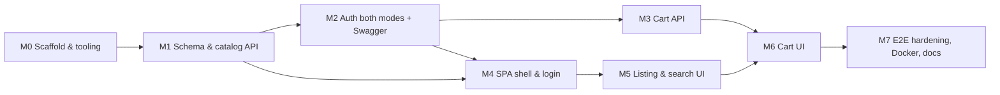

# 12 — Implementation Roadmap

> Starts only after "GREEN LIGHT: implement". After each milestone: run all tests, linters and the compose stack, report results honestly, and **pause for review**.
> Related: [09 DoD](09-testing-strategy.md#9-definition-of-done--per-feature) · [10 CI](10-code-quality-and-conventions.md#8-ci-quality-gates)

## 1. Milestone overview

Backend security is wired in M2; until then M1 endpoints are tested with `spring-security-test` mocks under a temporary "authenticated" rule so no unsecured code path ever lands on `main`.

## 2. Milestones

### M0 — Scaffold & tooling

**Tasks**: root files (`.gitignore`, `.editorconfig`, `.gitattributes`, `.env.example`, README skeleton); `backend/` Maven wrapper project (Boot 4.1.x, Java 17) with Spotless, Checkstyle, SpotBugs, JaCoCo, Enforcer, Failsafe, ArchUnit skeleton test; `frontend/` Vite React TS with ESLint/Prettier/Vitest/MSW/Playwright configs and a smoke test; Dockerfiles (hello-world level) and `compose.yaml` with MySQL + healthchecks; CI workflow with all jobs (E2E job running a placeholder spec); Dependabot; PR template; verify exact library versions.
**DoD**: `./mvnw verify` and `npm run ci` green locally and in CI; `docker compose up --wait` brings 3 healthy containers; READMEs explain commands.

### M1 — Schema & catalog API

**Tasks** (test-first): V1–V5 migrations + seed descriptions + 28 SVG placeholders; entities, repositories, `SearchTerm`, `ProductService`, `ProductController`, MapStruct mapper, `GlobalExceptionHandler`, OpenAPI config + first `docs/api/openapi.yaml` snapshot; Flyway IT, DataJpa search tests (accents/case/wildcards), `SearchExplainIT`, `ProductsIT`, contract validator wiring.
**Depends on**: M0. **DoD**: US-03/04/05 backend ACs covered; gates green; Swagger lists `listProducts`.

### M2 — Authentication (both modes) & Swagger Authorize

**Tasks**: **Spike first (≤ ½ day)** — verify GitHub PKCE support, loopback port rule, "check a token" endpoint behaviour with a real OAuth App you register (requires your client id/secret in `.env`, never committed); report findings before continuing. Then: Local AS (profile-gated) with in-memory users and two clients; `TokenAuthenticationManagerResolver`; `GitHubClient`, `GitHubTokenIntrospector` (+ Caffeine), `TokenExchangeController` + Bucket4j; CORS config; 401/403 Problem handlers; `MeController`; prod startup guard; Swagger OAuth config for both modes; all security tests in [09 §3.4](09-testing-strategy.md#34-security-tests); runbook GitHub setup section.
**Depends on**: M1. **DoD**: Swagger "Authorize" works in local mode (manually demonstrated + IT); GitHub mode demonstrated manually against your OAuth App; all security tests green.

### M3 — Cart API

**Tasks** (test-first): `RequestIdFilter` + Micrometer Tracing ids in logs and `traceId` in problems (NFR-OBS-02, moved from M1); V3 already applied; `Cart`, `CartItem`, `LineLimit`, `CartService` with optimistic locking/retry, `CartView` with `stockStatus`, `CartController`, Problem codes, concurrency IT, owner isolation IT, metrics.
**Depends on**: M2. **DoD**: US-06…09 backend ACs covered; OpenAPI snapshot updated.

### M4 — SPA shell & login

**Tasks**: `loadConfig`, `AuthProvider`, PKCE helpers (`oauth4webapi`), `RequireAuth`, `CallbackPage`, `LoginPage`, API client with Problem parsing and 401 re-auth, generated `schema.d.ts`, `AppShell`/`Header`/`UserMenu`/`SkipLink`, Tailwind tokens, nginx runtime config + headers; component tests; E2E `auth.spec`, `headers.spec`.
**Depends on**: M2 (M1 for types). **DoD**: US-01/02 ACs green end-to-end in compose (local mode).

### M5 — Listing & search UI

**Tasks**: `CatalogPage`, `ProductGrid`, `ProductCard` (clamped description), `SortSelect`, `SearchBox` (debounce/cancel), `Pagination`, URL params; component + a11y tests; E2E `catalog.spec`, `search.spec`.
**Depends on**: M4. **DoD**: US-03/04/05 green at all layers.

### M6 — Cart UI

**Tasks**: add-to-cart on cards, `CartBadge`, `CartPage`, `CartLine`, `QuantityStepper`, focus management, toasts/alerts; tests; E2E `cart.spec`.
**Depends on**: M3, M5. **DoD**: US-06…09 green at all layers.

### M7 — Hardening, E2E completeness, docs

**Tasks**: `a11y.spec`, `swagger.spec`, mobile project; image hardening checks; bundle budget; Lighthouse run recorded; traceability check script; `docs/architecture.md`, `runbook.md`, `security.md`, `CHANGELOG.md`; final README; clean-checkout verification (`git clone` → `docker compose up --wait` → E2E).
**Depends on**: M6. **DoD**: every gate in [09 §6](09-testing-strategy.md#6-coverage--quality-gates) green; review checklist signed off by you.

## 3. Reporting format after each milestone

Commands run and their outcome (pass/fail counts), coverage numbers vs gates, linter results, compose health status, known issues/deviations from plan, and questions for you. Failures are reported as failures, never hidden.

## 4. Dependencies on you

| When | What |
|---|---|
| M2 spike | Register a GitHub OAuth App (callback `http://127.0.0.1/`) and put `GITHUB_CLIENT_ID`/`GITHUB_CLIENT_SECRET` in a local `.env` — or let me design-verify only with WireMock and you test GitHub mode yourself |
| Every milestone | Review & approve before next milestone |
| CI | A GitHub repository to push to (none attached yet) |

## 5. Risks

| Risk | Likelihood | Impact | Mitigation |
|---|---|---|---|
| GitHub OAuth App PKCE or loopback-port behaviour differs from assumption | Med | High (login design) | M2 spike first; fallbacks in ADR-002; escalate to you |
| E2E never exercises the real GitHub path (D4) | Certain | Med | WireMock ITs; manual GitHub verification at M2 and M7 |
| Every API call depends on GitHub on cache miss (ADR-002) | Med | Med | 5-min cache, 503 + Retry-After, metrics alert-ready |
| Non-expiring GitHub tokens | Certain | Med | Memory-only storage; revoke-on-logout considered and declined (P7) |
| Boot 4 / Security 7 / Jackson 3 ecosystem maturity (springdoc, Testcontainers, MapStruct) | Low–Med | Med | Pin verified versions at M0; ADR-013 fallback to Boot 3.5 (commercial support only) |
| MySQL optimizer ignores index at tiny sizes making EXPLAIN test flaky | Med | Low | Test seeds 5k rows |
| Testcontainers needs Docker in CI and locally | Low | Med | GitHub-hosted Ubuntu runners have Docker; documented |
| Prefix-only search surprises users ("Monstera" ≠ "Swiss Cheese Monstera") | Med | Low | Accepted (D9); empty-state copy explains "start with" |
| Indefinite cart retention / no data deletion | Low | Low | Documented; out of scope |
| Single instance in-memory caches/rate limits | Low | Low | Documented limit (NFR-REL-07) |

## 6. Implementation notes (deviations recorded per milestone)

| Milestone | Note |
|---|---|
| M0 | google-java-format 1.28.0 / Checkstyle 10.26.1 (newest versions that run on Java 17); TypeScript 6.0 (typescript-eslint does not support 7 yet); ESLint 10 with an npm override for `eslint-plugin-jsx-a11y`; boundaries via core `no-restricted-imports`; Dockerfiles accept optional `extra_ca`/`maven_settings` build secrets. |
| M1 | OpenAPI emitted as 3.0 (validator/tooling compatibility). Contract validation uses `swagger-request-validator-core` 2.46.1 with an own MockMvc adapter. Money is a `String` DTO field formatted by `Money.format` (same wire format as planned). Until M2 the API chain has authorization rules but no token validation, so the running API answers 401; ITs use MockMvc with mock principals instead of RestClient + real tokens (switched in M2). `traceId` in problems moved to M3. Accented fixture rows are inserted with bound parameters, not inline `@Sql` literals. |
| M2 | No real-GitHub spike was possible in the sandbox (the browser login needs your machine); the GitHub path is verified against WireMock and the remaining checks are in the runbook ("Verify GitHub login"). Local AS logout is the OIDC endpoint `/connect/logout`. In prod, Local AS paths answer 401 from the deny-all chain rather than 404. The token-exchange rate limiter runs inside the API security chain after CORS, so 429s are readable by the SPA. `GitHubClient` uses `RestClient.builder()` (Boot 4 moved the `RestClient.Builder` bean to an optional module) and HTTP/1.1. The committed OpenAPI contract is generated with both auth modes so it contains every endpoint. Swagger "Authorize" E2E spec (planned for M7) was added now. |
